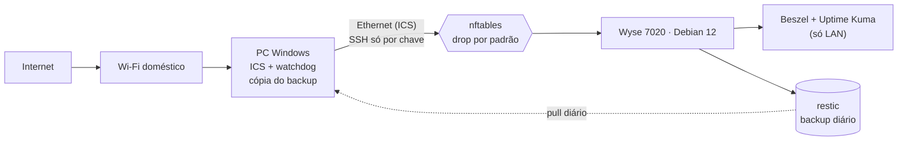

# HomeLab — Debian, rede, segurança e observabilidade em hardware de baixo custo

Uso um Dell Wyse 7020 (R$ 350) com Debian 12 para praticar administração Linux, diagnóstico de rede, endurecimento de servidor, containers, backup e observabilidade. O repositório registra comandos, decisões e **evidências** de cada marco. Nada é marcado como concluído sem teste.

## Estado atual

| Marco | Resultado observado | Estado | Registro |
|---|---|---|---|
| M0 — base Debian e SSH | Sistema atualizado; SSH a partir do Windows validado após reinício | **CONFIRMADO** | [M0](docs/marcos/M0-base-debian-ssh.md) |
| M1 — Docker | Engine e Compose; ciclo de vida de containers testado | **CONFIRMADO** | [M1](docs/marcos/M1-primeiro-experimento-docker.md) |
| M2 — rede, hora e segurança | Causa-raiz do ICS corrigida com watchdog; NTP + RTC; SSH só por chave; firewall nftables com portas do Docker bloqueadas por padrão; **rollback automático testado**; tudo persistente após reboot | **CONFIRMADO** (falta validar após reiniciar o PC Windows) | [M2](docs/marcos/M2-rede-seguranca-automacao.md) |
| M3 — observabilidade e backup | Beszel + Uptime Kuma no ar; backup restic diário com **restauração real testada**; cópia externa no PC; S.M.A.R.T. do pendrive | **EM ANDAMENTO** (painéis e alertas pendentes) | [M3](docs/marcos/M3-observabilidade-backup.md) |

## Arquitetura



[Arquitetura detalhada e limites](docs/arquitetura.md) · [Decisões (ADRs)](docs/decisoes/) · [Recuperação](docs/recuperacao.md)

## Destaques técnicos

- **Diagnóstico de causa-raiz:** "SSH funciona, internet não" vinha de o ICS não persistir após reiniciar (KB4055559) e de um estado "configurado sem NAT". O watchdog testa o **efeito** (o DNS do ICS responde), não só a configuração. ([ADR-001](docs/decisoes/ADR-001-ics-watchdog.md))
- **Mudanças sem trancar o acesso:** SSH e firewall entram com snapshot e reversão automática em 10 min. A reversão foi testada de propósito e restaurou o estado idêntico. ([M2](docs/marcos/M2-rede-seguranca-automacao.md))
- **Docker atrás do firewall:** a cadeia `forward` roda antes das regras do Docker; uma porta publicada só fica acessível se for liberada explicitamente para a LAN. Teste: bloqueada → liberada → bloqueada. ([ADR-002](docs/decisoes/ADR-002-firewall-nftables-docker.md))
- **Observabilidade enxuta:** Beszel (métricas, histórico, containers, S.M.A.R.T.) + Uptime Kuma (disponibilidade), com acesso só leitura ao Docker via proxy, limites de recursos e healthchecks. Cerca de 130 MiB no total. ([ADR-003](docs/decisoes/ADR-003-observabilidade-beszel-uptime-kuma.md))
- **Backup testado:** restic criptografado, retenção 7/4/6, restauração comparada byte a byte e uma cópia "pull" no PC que o servidor não consegue apagar. ([ADR-004](docs/decisoes/ADR-004-backup-restic-pull.md))

## Reproduzir

1. Debian 12 com um usuário administrador e acesso por **chave** SSH.
2. No servidor, com um clone deste repositório:
   ```bash
   sudo bash scripts/server/homelab-apply.sh <usuario-admin>        # hora, updates, SSH, firewall
   # validar um login novo por chave e confirmar em até 10 min:
   touch ~/.homelab-guard-confirm
   sudo bash scripts/server/homelab-m3-deploy.sh <usuario-admin> .  # monitoramento + backup
   ```
3. No Windows (se o servidor usa ICS): `scripts/windows/setup-ics-persistent.ps1` como administrador e `scripts/windows/register-backup-pull.ps1` como usuário.

Detalhes em [`scripts/README.md`](scripts/README.md). O contexto para agentes e manutenção está em [`CLAUDE.md`](CLAUDE.md).

## Ambiente

- **Hardware:** Dell Wyse 7020, AMD GX-420CA, 6 GB de RAM nominais (5,2 GiB úteis) e um **pendrive SATA de 32 GB** como disco.
- **Sistema:** Debian 12, kernel 6.1.0-56; Docker Engine 29.10.1 e Compose v5.8.0 (27/11/2026).
- **Uso medido** (27/11/2026, com o M3 no ar): cerca de 0,9 GiB de RAM e 28% do disco.
- **Rede:** PC Windows compartilha a internet por Ethernet (ICS). Topologia provisória.

## Próximo passo

Concluir o M3: criar as contas dos painéis, ligar o agente Beszel, configurar monitores e alertas, testar a chave de recuperação e a restauração a partir da cópia externa, e reiniciar o Wyse para provar que tudo volta sozinho. Ver o [roadmap](docs/proximos-passos.md).

Este laboratório é um ambiente de estudo. **Não é produção nem tem disponibilidade 24/7.**

**Registros:** [M0](docs/marcos/M0-base-debian-ssh.md) · [M1](docs/marcos/M1-primeiro-experimento-docker.md) · [M2](docs/marcos/M2-rede-seguranca-automacao.md) · [M3](docs/marcos/M3-observabilidade-backup.md) · [Plano M3/M4](docs/plano-monitoramento-automacao-backup.md) · [Scripts](scripts/)
