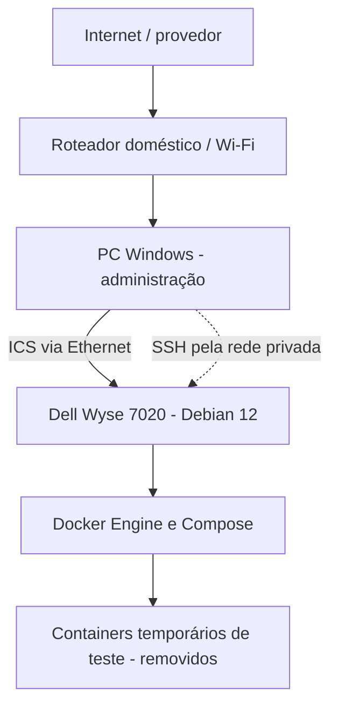
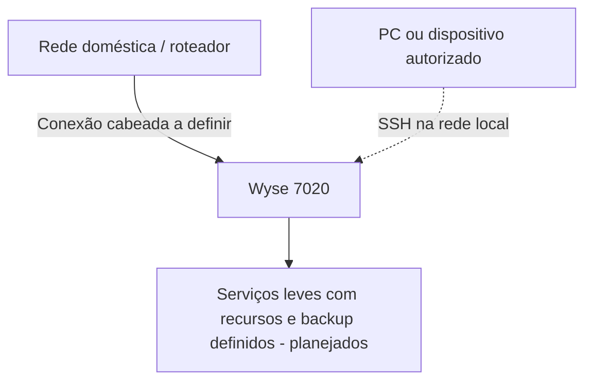

# Arquitetura atual do HomeLab

> **Registro de 16/10/2026.** A topologia a seguir mostra a conexão utilizada nos testes, não uma infraestrutura de produção.

## Topologia em uso

**Leitura correta:** o PC recebe internet pela rede doméstica e a compartilha com o Wyse pela Ethernet. O SSH utilizado parte do próprio PC. O Wi-Fi do Wyse não é o caminho de conectividade empregado. O fluxo é **provisório** e depende do Windows.

## Componentes confirmados

| Camada | Implementação observada | Situação |
|---|---|---|
| Hardware | Dell Wyse 7020, 6 GB RAM nominais, 32 GB de armazenamento nominal | **CONFIRMADO** |
| Sistema | Debian 12 Bookworm, modo texto por padrão, GNOME ainda instalado | **CONFIRMADO** |
| Acesso | SSH a partir do PowerShell no Windows | **CONFIRMADO**, inclusive em teste de reboot sem login local |
| Rede | Ethernet com ICS do Windows | **CONFIRMADO** na sessão |
| Containers | Docker Engine e Compose instalados e testados | **CONFIRMADO** |
| Aplicações permanentes | Nenhuma implantada neste marco | **NÃO EXECUTADO** |

### Como a rede foi diagnosticada

- O compartilhamento pelo Windows permitiu acesso ao Wyse e download de pacotes/imagens.
- Em reinicializações do Wyse, houve episódios de SSH funcional, mas **sem internet externa** no servidor.
- O serviço de compartilhamento do Windows continuava ativo; reiniciá-lo pelo PowerShell não solucionou o problema.
- **Solução temporária observada:** desligar e religar a opção de compartilhamento na interface Wi-Fi do Windows, restaurando a navegação do Wyse nas ocasiões testadas.
- **PENDENTE:** identificar a causa-raiz e confirmar uma recuperação automática sem intervenção.

O problema de internet do ICS não deve ser confundido com o estado do daemon SSH ou com falha do Docker. O repositório não publica endereços internos, nomes de usuário, MACs nem credenciais.

## Segurança e limites

- Nenhuma porta de container foi publicada nos experimentos.
- Nenhum encaminhamento de porta da internet foi configurado para este projeto.
- A administração é feita por SSH em rede privada, com monitor e teclado locais disponíveis durante mudanças arriscadas.
- Não foi comprovada disponibilidade contínua ou retorno automático da internet após cada reinício.
- As versões e medições são específicas das sessões; não são monitoramento em tempo real.

## Arquitetura desejada — ainda não implementada

O plano é retirar a dependência do compartilhamento de internet do Windows quando houver uma conexão física adequada, sem comprar hardware antes de demonstrar a necessidade.

**Não confundir intenção com implantação:** VPN, NAS, DNS doméstico, monitoramento contínuo e Minecraft não operam neste laboratório conforme as evidências atuais.

## Documentos relacionados

- [M0 — Base Debian e SSH](marcos/M0-base-debian-ssh.md)
- [M1 — Primeiro experimento com Docker](marcos/M1-primeiro-experimento-docker.md)
- [Próximos passos](proximos-passos.md)
