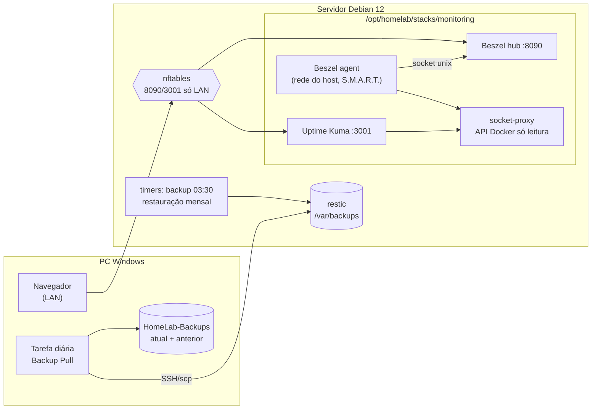

# M3 — Observabilidade, backup e recuperação

**Período:** 27/11/2026 · **Status:** **CONFIRMADO**. Monitoramento com histórico, disponibilidade, alertas reais, S.M.A.R.T., backup automatizado, restauração local **e** externa, e retorno automático após o reboot, tudo com evidência. Restam ações físicas (guardar a chave de recuperação fora do PC) e o item **PLANEJADO** de imagem completa do disco.

> Decisões e alternativas: [ADR-003](../decisoes/ADR-003-observabilidade-beszel-uptime-kuma.md) (observabilidade) e [ADR-004](../decisoes/ADR-004-backup-restic-pull.md) (backup).

## Arquitetura implantada



## O que foi implantado (CONFIRMADO)

Script: [`scripts/server/homelab-m3-deploy.sh`](../../scripts/server/homelab-m3-deploy.sh) · stack: [`stacks/monitoring/compose.yaml`](../../stacks/monitoring/compose.yaml)

| Item | Evidência |
|---|---|
| Pacotes | `restic 0.14.0`, `smartmontools 7.3` |
| S.M.A.R.T. do pendrive | `SMART overall-health self-assessment test result: PASSED` (o modelo expõe S.M.A.R.T. básico) |
| Stack Compose | `compose valido`; Beszel `healthy`; Uptime Kuma respondendo com healthcheck próprio da imagem (`extra/healthcheck`) |
| Firewall | `portas Docker liberadas para a LAN: 8090,3001`; Beszel `HTTP 200` e Kuma `HTTP 302` vistos do PC; as demais portas continuam descartadas |
| Guard | Reaplicação com guard confirmada só depois de validar o login por chave e a recusa da senha |
| Repositório restic | Criado com uma senha definida pela pessoa no terminal (fora do Git) |
| Primeiro backup | `snapshot=6a5f5b88`, repositório de 31 MB |
| **Teste real de restauração** | `ok itens=5 arquivos=5`: SSH, firewall, `backup.conf`, timesyncd e `compose.yaml` restaurados e **idênticos byte a byte** |
| Timers | `homelab-backup.timer` (03:30 ± 15 min, `Persistent=true`), `homelab-restore-test.timer` (dia 1, 04:30) |
| Cópia "pull" no PC | Tarefa `\HomeLab\HomeLab Backup Pull` com resultado `0x0`: `ok: 7 arquivos, 29,7 MB`, com a cópia atual e a anterior |
| Chave SSH de recuperação | Ed25519 **com frase-senha**, instalada no `authorized_keys` |

### Limites e consumo

| Container | Limite RAM / CPU | Medido logo após subir |
|---|---|---|
| beszel | 256 MiB / 1,0 | 12,8 MiB |
| beszel-agent | 128 MiB / 0,5 | ainda não conectado (aguarda chave) |
| uptime-kuma | 384 MiB / 1,0 | 98,3 MiB (pico de inicialização) |
| socket-proxy | 64 MiB / 0,25 | 19,5 MiB |

Host: RAM usada **934 MiB** (antes 600), `/` **28%** (antes 24%); `/var/lib/docker` 689 MB; sem unidades com falha.

## Problemas encontrados e resolvidos

| Problema | Causa | Correção |
|---|---|---|
| Tarefa de pull terminava com `0xFFFD0000` | O app que executou a instalação roda empacotado (MSIX) e **`%LOCALAPPDATA%` fica virtualizado** para ele; o Agendador não via o script | Script movido para `%USERPROFILE%\.homelab`. Conferido também que `C:\ProgramData\HomeLab` (gravado por um processo elevado) é real e tem o hash esperado |
| Reexecutar o `homelab-apply.sh` apagaria as portas liberadas | A lista ficava fixa no arquivo gerado | Lista movida para `/etc/homelab/docker-lan-tcp` |

## Sessão de 27/11/2026 — retomada e configuração dos painéis

### Auditoria somente leitura após ligar os equipamentos (CONFIRMADO)
O Wyse e o **PC Windows** foram ligados por volta das 11:45 (o Windows registrou o boot às 11:44:54). Nada foi presumido; tudo foi verificado de novo:

| Verificação | Resultado |
|---|---|
| SSH | Chave OK; senha e root `Permission denied (publickey)`; 2 chaves autorizadas (administração + recuperação) |
| **ICS após o boot do PC Windows** | Internet e DNS do servidor OK **sem nenhuma ação do watchdog** (o log não registra reaplicação depois do boot). A correção do Registro bastou. Esta era a pendência do M2 |
| Firewall visto do PC | 22, 8090 e 3001 abertas; 8080 e 2375 **descartadas** |
| Hora | NTP sincronizado (`c.st1.ntp.br`, +6 ms); RTC correto |
| Serviços | ssh, nftables, docker, containerd, timesyncd, NetworkManager e unattended-upgrades ativos; nenhuma unidade com falha |
| **Backup perdido (Wyse desligado às 03:30)** | Executado sozinho após o boot (`Persistent=true`): `snapshot=de8aeee0` às 11:59:32 |
| Cópia pull no PC | Tarefa no logon (11:55) e às 12:00 com `0x0`; a cópia contém o snapshot `de8aeee0` |
| Recursos | RAM 862 MiB; load 0,12; `/` 28%; 48 °C |

### Painéis configurados (CONFIRMADO)
- **Contas de administrador:** criadas pela pessoa no Beszel e no Uptime Kuma; as senhas não passaram pelo agente.
- **Agente Beszel:** sistema adicionado pelo socket unix; chave e token gravados em `secrets/` (0600, sem root). O agente conectou sozinho no ciclo seguinte e o sistema apareceu como "Ligado", com CPU, memória, disco, carga, rede, temperatura (`k10temp` 46 °C) e uptime. O **histórico** é gravado a cada minuto (`system_stats` e `container_stats`), incluindo os 4 contêineres.
- **socket-proxy só leitura comprovado:** `GET /containers/json` → 200; `POST /containers/beszel/restart` → **403**.
- **Uptime Kuma, 9 monitores, todos UP:**

| Monitor | Tipo | Resultado |
|---|---|---|
| Beszel (painel) | HTTP `beszel:8090/api/health` | 200 OK |
| SSH do servidor | TCP `host.docker.internal:22` | 3 ms |
| Internet | HTTPS espelho Debian | 200 OK |
| DNS público | DNS via 1.1.1.1 | resolvido |
| **ICS do Windows** | DNS via o gateway do ICS | resolvido; uma falha aqui significa que o compartilhamento do PC quebrou |
| Containers beszel, beszel-agent, socket-proxy | Docker via socket-proxy | running/healthy |
| Backup diário | **Push** (o backup avisa ao terminar; sem aviso em 26 h, alerta) | push de teste recebido |

- **Alertas:** ntfy com tópico aleatório (fora do Git), ligado aos 9 monitores do Kuma e às notificações do Beszel. O Beszel tem alertas de Status (1 min), CPU > 80% (10 min), RAM > 85% (10 min), Disco > 80% e Temperatura > 75 °C (5 min). **Entrega comprovada:** o histórico do tópico no ntfy mostra as duas mensagens de teste (Kuma e Beszel).

### Reboot do Wyse: a stack volta sozinha (CONFIRMADO)
Reinício autorizado pela pessoa às 12:12.

| Verificação | Resultado |
|---|---|
| Queda → SSH de volta | 12:12:35 → 12:13:17 (42 s); boot em 25,7 s; kernel 6.1.0-56 |
| Contêineres (via socket-proxy, sem root) | `beszel` healthy, `beszel-agent` healthy, `uptime-kuma` healthy (após o `start_period`), `socket-proxy` up: **todos voltaram sozinhos** (`restart: unless-stopped`) |
| Painéis vistos do PC | Beszel `200`, Kuma `302`; porta 8080 continua descartada |
| Beszel | Sistema `up`; histórico retomado; **S.M.A.R.T.: `/dev/sda` "32GB SATA Flash Drive" PASSED** (primeira coleta) |
| Uptime Kuma | 9 de 9 monitores **UP**, sem nenhum DOWN no histórico após o boot |
| SSH / serviços / rede | Senha recusada; ssh, nftables, docker e timesyncd ativos; DNS OK; NTP `yes`; nenhuma unidade com falha |
| Recursos | RAM 872 MiB; `/` 28% |

O reboot não gerou alerta, e isso é o comportamento desejado: a queda (42 s) ficou abaixo do limite de 1 min do alerta de Status do Beszel, e o Kuma reiniciava junto com o servidor.

### Alerta real, não só o botão de teste (CONFIRMADO)
Dois monitores temporários foram criados e depois apagados:
1. **TCP numa porta fechada:** o Kuma marcou DOWN e enviou `"TESTE de alerta (temporario) Down"` ("Connection failed").
2. **Push com transição UP → DOWN:** um push "vivo" e depois silêncio; após a janela de 20 s, DOWN e `"TESTE de alerta UP->DOWN (temporario) Down"` ("No heartbeat in the time window").

As duas mensagens aparecem no histórico do tópico ntfy. Esse segundo caminho é o mesmo do alerta de **backup atrasado**.

## Revisão técnica do PR #2 (27/11/2026): correções propostas, **não aplicadas no servidor**
A revisão apontou 9 pontos. As correções estão no repositório e testadas em sandbox; o servidor segue com a versão anterior, validada acima, até a aplicação ser autorizada.

| # | Ponto | Correção | Registro |
|---|---|---|---|
| 1 | Consistência da cópia externa | Lock único backup/restauração/prune; **export imutável** com manifesto, trocado sob lock; pull com `flock -s` + validação do manifesto | ADR-004 |
| 2 | Logs, temporários e configs de root | Logs em `/var/log/homelab`; config lida sem `source` e com dono/modo verificados; `mktemp`; URL de push não confiável | ADR-007, ADR-004 |
| 3 | Parar/religar contêineres | Registro antes do `stop`, religamento garantido, falha se não voltarem | ADR-004 |
| 4 | Falso positivo na restauração externa | `--verify`, contagem igual à do snapshot, `PRAGMA integrity_check` nos bancos | ADR-004 |
| 5 | Códigos de saída | `hl_finish` em todos os scripts | ADR-007 |
| 6 | Firewall: sub-rede, IPv6, portas do Docker | `firewall.conf` com `ALLOWED_V4/V6`; IPv6 e docker-proxy cobertos | ADR-002 |
| 7 | Rollback: falhas parciais e concorrência | Lock, recusa com pendência, reversão imediata, snapshot em memória | ADR-007 |
| 8 | Chave de recuperação | Testar **a cópia externa** antes de apagar a local | [recuperação](../recuperacao.md) |
| 9 | Privacidade do ntfy e limites do monitoramento | Documentados | ADR-003 |

**Testes:** [`tests/`](../../tests/). Servidor **58/58** em sandbox (`unshare -rnm`, nft real em rede isolada, restic real) e Windows **12/12**: **70 aprovados** (rodada final; os testes de regressão falham no código anterior). Migração proposta: [`docs/migracao-pr2.md`](../migracao-pr2.md). Evidências em [`tests/evidencias/`](../../tests/evidencias/).

**Variáveis de teste não abrem brecha em produção:** os caminhos `HL_*`/`HL_PATH`, usados pelos testes, só valem dentro de um namespace de usuário. Num root real, o bloco `hl-env` de cada script apaga todas elas antes de definir o `PATH` fixo. Isso foi comprovado no namespace real do servidor com `HL_PATH=/maligno` (detalhes em [`tests/README.md`](../../tests/README.md)).

**Incidente durante os testes (registrado por transparência):** na primeira execução, o `export PATH` fixo dos scripts anulou os mocks, e alguns testes chamaram o `systemctl`/`systemd-run` reais. O host **negou** as chamadas (polkit: "Interactive authentication required"), porque o namespace não tem privilégio real. Os hashes e datas de `sshd_config.d` e `nftables.conf`, os serviços e os contêineres foram conferidos e estavam **inalterados**. Correção: `HL_PATH` respeitado só no sandbox, uma trava que aborta a suíte se algum comando não resolver para o mock, um teste que prova o uso dos mocks e um `tmpfs` privado em `/tmp`.

### O que está testado em sandbox × o que está implantado no servidor
| Item | Implantado no servidor (27/11, validado acima) | Correção do PR #2 |
|---|---|---|
| Cópia externa | **Export imutável + manifesto + `flock`** | **IMPLANTADO em 27/11** (migração parcial; restauração externa da nova geração OK) |
| Pausa/religamento no backup | **Versão nova** (consulta que falha não confirma) | **IMPLANTADO em 27/11** |
| Restauração (local e externa) | **`--verify`, contagem e `integrity_check`** | **IMPLANTADO em 27/11** (local e externa OK) |
| Firewall | Todas as faixas RFC 1918; portas 8090/3001 (inalterado) | Sub-rede autorizada + IPv6: testado em sandbox, **PENDENTE (fase 3)** |
| Guard | Versão anterior (inalterada) | Lock, recusa, reversão imediata, snapshot em memória: testado em sandbox, **PENDENTE (fase 3)** |
| Logs de root | **`/var/log/homelab`** (backup e restauração); histórico antigo em `legado/` | **IMPLANTADO em 27/11** (apply continua com a versão anterior até a fase 3) |
| Guarda `hl-env` | **Ativa** nos 3 scripts de backup/restauração instalados | **IMPLANTADA em 27/11**; apply e guard-rollback na fase 3 |
| Cópia pull no Windows | **Script e módulo novos** (manifesto, rotação recuperável, lock) | **IMPLANTADO em 27/11** (tarefa reinstalada; `0x0`) |
| Documentação (chave de recuperação, ntfy, limites) | — | Publicada |

Migração **parcial** executada em 27/11/2026 (fases 1, 2 reduzida, 4 e 5), com evidências em [`docs/migracao-pr2.md`](../migracao-pr2.md#execução-parcial-27112026). A **fase 3** (SSH/firewall/guard) segue pendente até haver console físico e a chave de recuperação validada. Achado resolvido: o push do backup falhava porque o Kuma ainda estava reiniciando. O retry (`dc8170a`) foi implantado em 27/11/2026 e o push foi confirmado na 2ª tentativa (**CONFIRMADO**, ver `docs/migracao-pr2.md`).

## Pendente

| Item | Estado |
|---|---|
| S.M.A.R.T. no painel do Beszel | **CONFIRMADO** após o reboot (ver acima) |
| Página "Todos os Contêineres" do Beszel | Vazia na interface, mas as métricas dos contêineres **estão** no histórico e nos gráficos do sistema. Investigar numa versão futura |
| Inscrição no tópico ntfy no celular | **PENDENTE** (ação da pessoa no app ntfy) |
| Testar o login com a chave de recuperação | Executado pela pessoa (frase-senha); resultado informado por ela |
| Guardar a chave de recuperação fora do PC e apagá-la do disco | **PENDENTE** (ação física da pessoa) |

### Troca da senha antiga do Debian (CONFIRMADO)
Feita pela pessoa numa sessão interativa (`passwd`). A nova senha foi validada em seguida com `sudo -k; sudo -v` e usada no passo seguinte. Em `chage -l`: última mudança **27/11/2026** (antes, 2013). A senha não passou por arquivos, scripts nem pelo agente.

### Restauração a partir da cópia EXTERNA (CONFIRMADO)
Script: [`scripts/server/homelab-external-restore-test.sh`](../../scripts/server/homelab-external-restore-test.sh). A cópia pull do PC (`HomeLab-Backups\restic`) foi levada para o servidor e aberta com a **senha do backup digitada pela pessoa**, ou seja, a senha guardada no gerenciador funciona:

```text
de8aeee0  2026-11-27 11:59:27   (1 snapshot)
check --read-data: 5/5 packs, no errors were found
igual: /etc/ssh/sshd_config.d, /etc/nftables.conf, /etc/homelab/backup.conf,
       /etc/systemd/timesyncd.conf.d, /opt/homelab/stacks/monitoring/compose.yaml
dados do Beszel/Kuma restaurados: 788K
EXTERNAL_RESTORE_OK itens=5 2026-11-27T12:10:48-03:00
```

A cópia temporária foi apagada do servidor depois do teste.
| Reiniciar o Wyse e provar que a stack volta sozinha | **CONFIRMADO** (27/11, 12:13) |
| Imagem completa do pendrive (Clonezilla) | **PLANEJADO** |
