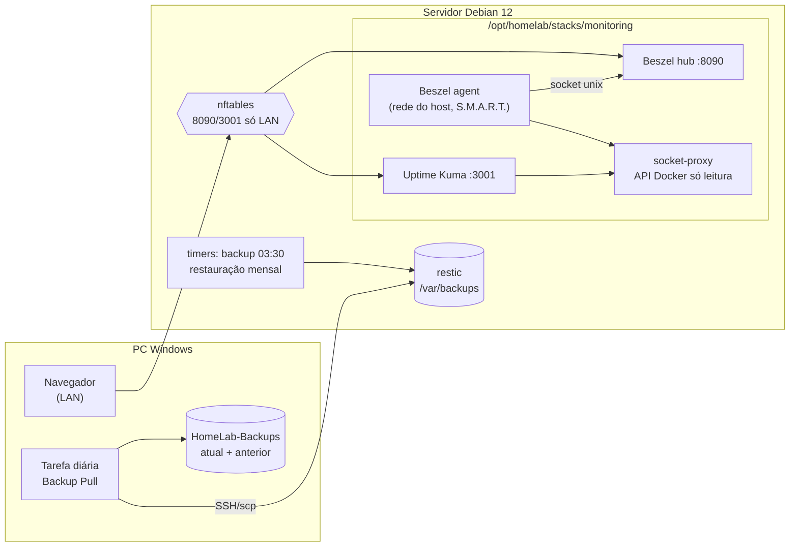

# M3 — Observabilidade, backup e recuperação

**Início:** 27/11/2026 · **Status:** **EM ANDAMENTO**. A infraestrutura está implantada e o backup foi validado; os painéis ainda não foram configurados.

> Decisões e alternativas: [ADR-003](../decisoes/ADR-003-observabilidade-beszel-uptime-kuma.md) (observabilidade) e [ADR-004](../decisoes/ADR-004-backup-restic-pull.md) (backup).

## Arquitetura implantada

## O que foi implantado (CONFIRMADO)

Script: [`scripts/server/homelab-m3-deploy.sh`](../../scripts/server/homelab-m3-deploy.sh) · stack: [`stacks/monitoring/compose.yaml`](../../stacks/monitoring/compose.yaml)

| Item | Evidência |
|---|---|
| Pacotes | `restic 0.14.0`, `smartmontools 7.3` |
| S.M.A.R.T. do pendrive | `SMART overall-health self-assessment test result: PASSED` (o modelo expõe S.M.A.R.T. básico) |
| Stack Compose | `compose valido`; Beszel `healthy`; Uptime Kuma respondendo com healthcheck próprio da imagem (`extra/healthcheck`) |
| Firewall | `portas Docker liberadas para a LAN: 8090,3001`; Beszel `HTTP 200` e Kuma `HTTP 302` vistos do PC; as demais portas continuam descartadas |
| Guard | Reaplicação com guard confirmada só depois de validar o login por chave e a recusa da senha |
| Repositório restic | Criado com uma senha definida pela pessoa no terminal (fora do Git) |
| Primeiro backup | `snapshot=6a5f5b88`, repositório de 31 MB |
| **Teste real de restauração** | `ok itens=5 arquivos=5`: SSH, firewall, `backup.conf`, timesyncd e `compose.yaml` restaurados e **idênticos byte a byte** |
| Timers | `homelab-backup.timer` (03:30 ± 15 min, `Persistent=true`), `homelab-restore-test.timer` (dia 1, 04:30) |
| Cópia "pull" no PC | Tarefa `\HomeLab\HomeLab Backup Pull` com resultado `0x0`: `ok: 7 arquivos, 29,7 MB`, com a cópia atual e a anterior |
| Chave SSH de recuperação | Ed25519 **com frase-senha**, instalada no `authorized_keys` |

### Limites e consumo

| Container | Limite RAM / CPU | Medido logo após subir |
|---|---|---|
| beszel | 256 MiB / 1,0 | 12,8 MiB |
| beszel-agent | 128 MiB / 0,5 | ainda não conectado (aguarda chave) |
| uptime-kuma | 384 MiB / 1,0 | 98,3 MiB (pico de inicialização) |
| socket-proxy | 64 MiB / 0,25 | 19,5 MiB |

Host: RAM usada **934 MiB** (antes 600), `/` **28%** (antes 24%); `/var/lib/docker` 689 MB; sem unidades com falha.

## Problemas encontrados e resolvidos

| Problema | Causa | Correção |
|---|---|---|
| Tarefa de pull terminava com `0xFFFD0000` | O app que executou a instalação roda empacotado (MSIX) e **`%LOCALAPPDATA%` fica virtualizado** para ele; o Agendador não via o script | Script movido para `%USERPROFILE%\.homelab`. Conferido também que `C:\ProgramData\HomeLab` (gravado por um processo elevado) é real e tem o hash esperado |
| Reexecutar o `homelab-apply.sh` apagaria as portas liberadas | A lista ficava fixa no arquivo gerado | Lista movida para `/etc/homelab/docker-lan-tcp` |

## Pendente

| Item | Estado |
|---|---|
| Criar as contas de administrador do Beszel e do Uptime Kuma | **PENDENTE**: a pessoa define as senhas |
| Ligar o agente Beszel (chave e token do hub em `secrets/`) | **PENDENTE**: o agente reinicia em loop até lá (esperado) |
| Monitores do Uptime Kuma (HTTP dos painéis, SSH, DNS, internet, containers, push do backup) | **PENDENTE** |
| Alertas (ntfy com tópico aleatório, fora do Git) no Beszel e no Kuma | **PENDENTE** |
| Histórico de métricas e alerta de S.M.A.R.T. no Beszel | **PENDENTE** (depende do agente) |
| Testar o login com a chave de recuperação e guardá-la fora do PC | **PENDENTE** (exige a frase-senha) |
| Restaurar a partir da **cópia externa** (no PC) | **PENDENTE** |
| Reiniciar o Wyse e provar que a stack volta sozinha | **PENDENTE** |
| Imagem completa do pendrive (Clonezilla) | **PLANEJADO** |
