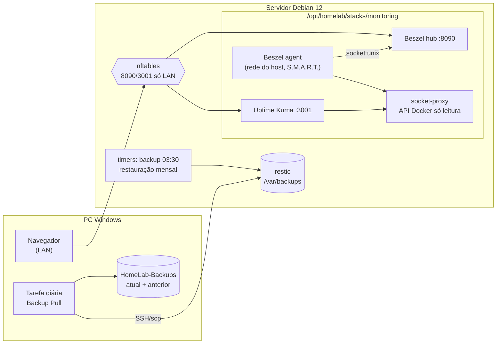

# M3 — Observabilidade, backup e recuperação

**Início:** 27/11/2026 · **Status:** **EM ANDAMENTO**. A infraestrutura está implantada e o backup foi validado; os painéis ainda não foram configurados.

> Decisões e alternativas: [ADR-003](../decisoes/ADR-003-observabilidade-beszel-uptime-kuma.md) (observabilidade) e [ADR-004](../decisoes/ADR-004-backup-restic-pull.md) (backup).

## Arquitetura implantada



## O que foi implantado (CONFIRMADO)

Script: [`scripts/server/homelab-m3-deploy.sh`](../../scripts/server/homelab-m3-deploy.sh) · stack: [`stacks/monitoring/compose.yaml`](../../stacks/monitoring/compose.yaml)

| Item | Evidência |
|---|---|
| Pacotes | `restic 0.14.0`, `smartmontools 7.3` |
| S.M.A.R.T. do pendrive | `SMART overall-health self-assessment test result: PASSED` (o modelo expõe S.M.A.R.T. básico) |
| Stack Compose | `compose valido`; Beszel `healthy`; Uptime Kuma respondendo com healthcheck próprio da imagem (`extra/healthcheck`) |
| Firewall | `portas Docker liberadas para a LAN: 8090,3001`; Beszel `HTTP 200` e Kuma `HTTP 302` vistos do PC; as demais portas continuam descartadas |
| Guard | Reaplicação com guard confirmada só depois de validar o login por chave e a recusa da senha |
| Repositório restic | Criado com uma senha definida pela pessoa no terminal (fora do Git) |
| Primeiro backup | `snapshot=6a5f5b88`, repositório de 31 MB |
| **Teste real de restauração** | `ok itens=5 arquivos=5`: SSH, firewall, `backup.conf`, timesyncd e `compose.yaml` restaurados e **idênticos byte a byte** |
| Timers | `homelab-backup.timer` (03:30 ± 15 min, `Persistent=true`), `homelab-restore-test.timer` (dia 1, 04:30) |
| Cópia "pull" no PC | Tarefa `\HomeLab\HomeLab Backup Pull` com resultado `0x0`: `ok: 7 arquivos, 29,7 MB`, com a cópia atual e a anterior |
| Chave SSH de recuperação | Ed25519 **com frase-senha**, instalada no `authorized_keys` |

### Limites e consumo

| Container | Limite RAM / CPU | Medido logo após subir |
|---|---|---|
| beszel | 256 MiB / 1,0 | 12,8 MiB |
| beszel-agent | 128 MiB / 0,5 | ainda não conectado (aguarda chave) |
| uptime-kuma | 384 MiB / 1,0 | 98,3 MiB (pico de inicialização) |
| socket-proxy | 64 MiB / 0,25 | 19,5 MiB |

Host: RAM usada **934 MiB** (antes 600), `/` **28%** (antes 24%); `/var/lib/docker` 689 MB; sem unidades com falha.

## Problemas encontrados e resolvidos

| Problema | Causa | Correção |
|---|---|---|
| Tarefa de pull terminava com `0xFFFD0000` | O app que executou a instalação roda empacotado (MSIX) e **`%LOCALAPPDATA%` fica virtualizado** para ele; o Agendador não via o script | Script movido para `%USERPROFILE%\.homelab`. Conferido também que `C:\ProgramData\HomeLab` (gravado por um processo elevado) é real e tem o hash esperado |
| Reexecutar o `homelab-apply.sh` apagaria as portas liberadas | A lista ficava fixa no arquivo gerado | Lista movida para `/etc/homelab/docker-lan-tcp` |

## Sessão de 27/11/2026 — retomada e configuração dos painéis

### Auditoria somente leitura após ligar os equipamentos (CONFIRMADO)
O Wyse e o **PC Windows** foram ligados por volta das 11:45 (o Windows registrou o boot às 11:44:54). Nada foi presumido; tudo foi verificado de novo:

| Verificação | Resultado |
|---|---|
| SSH | Chave OK; senha e root `Permission denied (publickey)`; 2 chaves autorizadas (administração + recuperação) |
| **ICS após o boot do PC Windows** | Internet e DNS do servidor OK **sem nenhuma ação do watchdog** (o log não registra reaplicação depois do boot). A correção do Registro bastou. Esta era a pendência do M2 |
| Firewall visto do PC | 22, 8090 e 3001 abertas; 8080 e 2375 **descartadas** |
| Hora | NTP sincronizado (`c.st1.ntp.br`, +6 ms); RTC correto |
| Serviços | ssh, nftables, docker, containerd, timesyncd, NetworkManager e unattended-upgrades ativos; nenhuma unidade com falha |
| **Backup perdido (Wyse desligado às 03:30)** | Executado sozinho após o boot (`Persistent=true`): `snapshot=de8aeee0` às 11:59:32 |
| Cópia pull no PC | Tarefa no logon (11:55) e às 12:00 com `0x0`; a cópia contém o snapshot `de8aeee0` |
| Recursos | RAM 862 MiB; load 0,12; `/` 28%; 48 °C |

### Painéis configurados (CONFIRMADO)
- **Contas de administrador:** criadas pela pessoa no Beszel e no Uptime Kuma; as senhas não passaram pelo agente.
- **Agente Beszel:** sistema adicionado pelo socket unix; chave e token gravados em `secrets/` (0600, sem root). O agente conectou sozinho no ciclo seguinte e o sistema apareceu como "Ligado", com CPU, memória, disco, carga, rede, temperatura (`k10temp` 46 °C) e uptime. O **histórico** é gravado a cada minuto (`system_stats` e `container_stats`), incluindo os 4 contêineres.
- **socket-proxy só leitura comprovado:** `GET /containers/json` → 200; `POST /containers/beszel/restart` → **403**.
- **Uptime Kuma, 9 monitores, todos UP:**

| Monitor | Tipo | Resultado |
|---|---|---|
| Beszel (painel) | HTTP `beszel:8090/api/health` | 200 OK |
| SSH do servidor | TCP `host.docker.internal:22` | 3 ms |
| Internet | HTTPS espelho Debian | 200 OK |
| DNS público | DNS via 1.1.1.1 | resolvido |
| **ICS do Windows** | DNS via o gateway do ICS | resolvido; uma falha aqui significa que o compartilhamento do PC quebrou |
| Containers beszel, beszel-agent, socket-proxy | Docker via socket-proxy | running/healthy |
| Backup diário | **Push** (o backup avisa ao terminar; sem aviso em 26 h, alerta) | push de teste recebido |

- **Alertas:** ntfy com tópico aleatório (fora do Git), ligado aos 9 monitores do Kuma e às notificações do Beszel. O Beszel tem alertas de Status (1 min), CPU > 80% (10 min), RAM > 85% (10 min), Disco > 80% e Temperatura > 75 °C (5 min). **Entrega comprovada:** o histórico do tópico no ntfy mostra as duas mensagens de teste (Kuma e Beszel).

## Pendente

| Item | Estado |
|---|---|
| S.M.A.R.T. no painel do Beszel | **PENDENTE DE VALIDAÇÃO**: a coleta é de hora em hora; a tabela ainda está vazia |
| Página "Todos os Contêineres" do Beszel | Vazia na interface, mas as métricas dos contêineres **estão** no histórico e nos gráficos do sistema |
| Inscrição no tópico ntfy no celular | Feita pela pessoa (app ntfy) |
| Testar o login com a chave de recuperação | Executado pela pessoa (frase-senha); resultado informado por ela |
| Guardar a chave de recuperação fora do PC e apagá-la do disco | **PENDENTE** (ação física da pessoa) |

### Troca da senha antiga do Debian (CONFIRMADO)
Feita pela pessoa numa sessão interativa (`passwd`). A nova senha foi validada em seguida com `sudo -k; sudo -v` e usada no passo seguinte. Em `chage -l`: última mudança **27/11/2026** (antes, 2013). A senha não passou por arquivos, scripts nem pelo agente.

### Restauração a partir da cópia EXTERNA (CONFIRMADO)
Script: [`scripts/server/homelab-external-restore-test.sh`](../../scripts/server/homelab-external-restore-test.sh). A cópia pull do PC (`HomeLab-Backups\restic`) foi levada para o servidor e aberta com a **senha do backup digitada pela pessoa**, ou seja, a senha guardada no gerenciador funciona:

```text
de8aeee0  2026-11-27 11:59:27   (1 snapshot)
check --read-data: 5/5 packs, no errors were found
igual: /etc/ssh/sshd_config.d, /etc/nftables.conf, /etc/homelab/backup.conf,
       /etc/systemd/timesyncd.conf.d, /opt/homelab/stacks/monitoring/compose.yaml
dados do Beszel/Kuma restaurados: 788K
EXTERNAL_RESTORE_OK itens=5 2026-11-27T12:10:48-03:00
```

A cópia temporária foi apagada do servidor depois do teste.
| Reiniciar o Wyse e provar que a stack volta sozinha | **PENDENTE** (aguarda autorização) |
| Imagem completa do pendrive (Clonezilla) | **PLANEJADO** |
