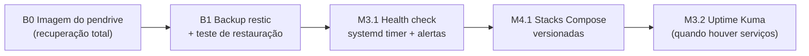

# Plano — monitoramento, automação e backup (M3/M4)

**Revisão:** 27/11/2026 · **Estado:** parte implantada. O que já foi feito e validado está no [M3](marcos/M3-observabilidade-backup.md), e as escolhas finais estão nos [ADRs](decisoes/). Mudanças desde a primeira versão:
- o health check próprio (M3.1) foi **substituído** pelo Beszel e pelo Uptime Kuma, para não ter ferramentas redundantes;
- a cópia externa do backup é um **pull** pelo PC (ADR-004), em vez de um servidor SFTP no Windows;
- o Ansible foi avaliado e adiado (ADR-005).

## Restrições que orientam o plano

| Restrição | Consequência |
|---|---|
| Raiz num **pendrive SATA de 32 GB** | É o maior risco de perda total. Evitar escrita contínua (sem bancos de métricas locais pesados). **Backup e imagem do disco vêm antes de qualquer serviço** |
| **5,2 GiB** de RAM, cerca de 600 MiB usados no boot | Cabe monitoramento leve. Stacks como Prometheus + Grafana + Loki ficam adiadas |
| Internet só pelo **ICS do PC Windows** | Alertas pela internet falham justamente quando a rede cai, então o servidor precisa guardar o alerta e enviar quando a conexão voltar |
| Bateria CMOS provavelmente gasta | Hora certa depende do NTP no boot; o health check também verifica isso |
| Custo zero | Só software livre e camadas gratuitas, e o plano não pode depender delas |

## Ordem proposta

Backup vem primeiro: sem ele, um pendrive com defeito apaga também o histórico do monitoramento.

## 1. Backup

### B0 — Imagem completa do disco (uma vez e após grandes mudanças)
- Desligar o Wyse e gerar uma imagem do pendrive com **Clonezilla** (live USB, gratuito) para um disco externo ou para o PC.
- **Pronto quando:** existir uma imagem restaurável e o procedimento estiver escrito aqui.

### B1 — Backup de arquivos com restic
- **Ferramenta:** `restic` (Debian, gratuito, criptografado, com deduplicação).
- **O que entra:**
  - `/etc`;
  - `/opt/homelab` (arquivos Compose e volumes dos serviços);
  - a home do administrador, sem cache;
  - a lista de pacotes (`dpkg --get-selections`, `apt-mark showmanual`);
  - um `docker volume export` de cada volume nomeado.
- **Destinos (3-2-1 adaptado):**
  1. **Local:** um disco USB externo no próprio Wyse.
  2. **Outro equipamento:** o PC Windows via SFTP. Isso exige ativar o recurso OpenSSH Server do Windows, uma mudança de sistema que precisa de autorização.
  3. **Fora de casa (opcional):** um provedor com camada gratuita compatível com restic, a avaliar na época, sem depender dela.
- **Agenda:** timer systemd diário (`restic backup` e depois `restic forget --keep-daily 7 --keep-weekly 4 --keep-monthly 6 --prune`).
- **Segredos:** a senha do repositório restic fica num gerenciador de senhas, **fora** do servidor e fora do Git. No servidor, só num arquivo `0600` lido pelo serviço.
- **Pronto quando:** uma **restauração de teste** de `/etc` e de um volume, para um diretório temporário, for feita e registrada. Depois disso, repetir todo mês.

### B2 — Histórico de configuração
- `etckeeper`, que faz commit automático do `/etc` a cada `apt` e mostra *o que mudou e quando*. Ele complementa o backup, não o substitui.

## 2. Monitoramento

### M3.1 — Health check leve (primeiro passo)
Um script `homelab-health` rodando por timer systemd a cada 5 min. Ele grava no journal e alerta só quando o estado **muda**.

| Verificação | Alerta quando |
|---|---|
| Internet e DNS (`deb.debian.org`) | Falha em 2 execuções seguidas |
| `NTPSynchronized` | `no` por mais de 15 min |
| Disco `/` e inodes | Acima de 80% |
| RAM disponível | Abaixo de 500 MiB |
| Temperatura (`k10temp`) | Acima de 75 °C |
| `systemctl --failed` | Qualquer unidade |
| `/var/run/reboot-required` | Presente por mais de 7 dias |
| Docker, SSH e nftables | Não `active` |
| Último backup restic | Mais de 26 h atrás |

- **Canal de alerta:** **ntfy**, gratuito, com app no celular e tópico de nome aleatório guardado só em `/etc/homelab/alert.env` (`0600`). Alternativa: um bot do Telegram. Se a internet estiver fora, o alerta fica numa fila local e sai quando a conexão voltar.
- **Pronto quando:** cada alerta for disparado de propósito uma vez (por exemplo, encher um arquivo temporário até passar de 80%), com o recebimento registrado.

### M3.2 — Uptime Kuma (quando houver serviços)
- Um container (cerca de 100 MB de RAM) para checks HTTP/TCP e uma página de status.
- Porta publicada **só para a rede local**, colocando a porta em `docker_lan_tcp` no firewall.

### Adiado
- Prometheus + node_exporter + Grafana: só se surgir uma pergunta que o health check não responde. O custo é RAM e escrita contínua no pendrive.

## 3. Automação

| Item | Plano |
|---|---|
| Configuração do servidor | Os scripts idempotentes em [`scripts/`](../scripts/) são a fonte da verdade. Toda mudança entra por eles e por um commit |
| Serviços | Um diretório por stack em `/opt/homelab/stacks/<nome>/compose.yaml`, versionado aqui (sem `.env` com segredos). Cada stack declara limite de memória (`mem_limit`), política de restart e rotação de logs |
| Portas | Por padrão, nenhuma porta publicada fica acessível. Liberar uma porta é uma mudança explícita no `nftables.conf` (`docker_lan_tcp`) |
| Atualizações | Atualizações de segurança automáticas (já ativas). Imagens Docker atualizadas manualmente e com registro (sem Watchtower, para não ter mudanças invisíveis) |
| Ansible | Adiado. Só compensa com mais de um host ou quando os scripts ficarem difíceis de manter |
| Windows | Watchdog do ICS já ativo. Depois, avaliar sair do ICS e ligar o Wyse direto no roteador, o que elimina a dependência do PC |

## 4. Itens de segurança pendentes

- **Trocar a senha antiga do administrador** (usada só no console e no `sudo`, já que o SSH não aceita senha):
  1. abrir uma sessão interativa (`ssh -t <alias> passwd`), digitar a senha atual e a nova duas vezes, sem registrar nada em arquivo;
  2. **antes de fechar essa sessão**, abrir outra e testar `sudo -v` com a senha nova;
  3. guardar a senha nova num gerenciador de senhas.

  O console local continua sendo a recuperação. Se a senha nova for perdida, só o modo de recuperação do GRUB devolve o acesso.
- **Bateria CMOS (CR2032):** trocar. Com isso, o RTC deixa de voltar para 2013 em quedas de energia.
- **Desktop GNOME instalado sem uso:** avaliar a remoção (libera disco e reduz o que precisa ser atualizado) depois do backup B1.

## Critério para sair do papel

Cada item só muda para **CONFIRMADO** com a evidência registrada num marco (comando, saída e data), como nos marcos M0 a M2.
